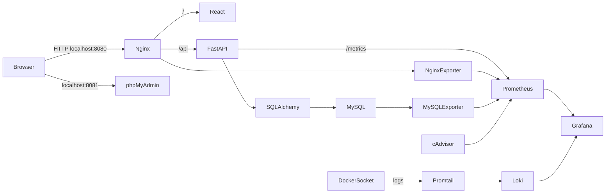

# CRM Chăm sóc khách hàng

Ứng dụng CRM tiếng Việt dành cho đồ án sinh viên. Frontend React + TypeScript,
API FastAPI, SQLAlchemy/MySQL, Nginx reverse proxy; phần giám sát và log được
tách thành các Docker Compose override để triển khai theo từng giai đoạn.

> Đây là cấu hình demo chạy trên máy cá nhân, không phải cấu hình production.
> Các cổng web chỉ bind vào `127.0.0.1`, ứng dụng dùng HTTP nội bộ và chưa bật
> HTTPS. Hãy thay mọi giá trị `CHANGE_ME` trong `.env` trước khi khởi động.

## Kiến trúc



```text
CRM-Cham-Soc-Khach-Hang/
|-- backend/                 FastAPI, SQLAlchemy models, API, Dockerfile
|   `-- app/
|-- database/init/           Tạo tài khoản exporter MySQL khi khởi tạo volume
|-- frontend/                React + TypeScript + Vite, Dockerfile
|   `-- src/
|-- nginx/default.conf       Reverse proxy, security headers, access log JSON
|-- prometheus/prometheus.yml Scrape app, Nginx, MySQL, cAdvisor
|-- grafana/
|   |-- dashboards/          Dashboard CRM được provision tự động
|   `-- provisioning/        Prometheus và Loki data source
|-- loki/config.yml          Lưu log demo 7 ngày
|-- promtail/config.yml      Docker service discovery và nhãn log
|-- tests/backend/           pytest API/integration tests với SQLite tạm
|-- docker-compose.yml       CRM, MySQL, Nginx và phpMyAdmin (profile admin)
|-- docker-compose.monitoring.yml
|-- docker-compose.logging.yml
|-- .env.example             Mẫu biến môi trường, không chứa secret thật
`-- README.md
```

| Dịch vụ | Cổng máy chủ | Vai trò |
|---|---:|---|
| Nginx | 8080 | Điểm truy cập CRM, proxy `/api/`, security headers |
| MySQL | Không publish | Database chỉ ở network Docker nội bộ |
| phpMyAdmin | 8081 | Công cụ quản trị, chỉ chạy khi dùng profile `admin` |
| Prometheus | 9090 | Thu thập và tra cứu metrics |
| Grafana | 3000 | Dashboard metrics và khám phá log |
| FastAPI | Không publish | API, tài liệu OpenAPI nội bộ và `/metrics` |
| Loki / Promtail | Không publish | Lưu log / đọc Docker logs |
| Exporters / cAdvisor | Không publish | Metrics Nginx, MySQL, container |

Network `application` và `monitoring` là internal để giữ kết nối service riêng.
Network `edge` chỉ kết nối những dịch vụ cần host port (Nginx, phpMyAdmin,
Prometheus, Grafana); các cổng được bind vào localhost. Database không có port
publish và không tham gia network `edge`.
Promtail cần truy cập Docker Engine socket để phát hiện container; socket này
có quyền rất cao dù mount `:ro`, nên không dùng cấu hình này trên máy chủ dùng
chung hoặc môi trường production.

## Yêu cầu trước khi chạy

- Windows 10/11, VS Code và PowerShell.
- Git.
- Docker Desktop đã khởi động với Linux containers và Docker Compose v2.
- Khuyến nghị ít nhất 4 GB RAM dành cho Docker nếu chạy cả stack monitoring.

Kiểm tra công cụ:

```powershell
git --version
docker version
docker compose version
```

Mở chính thư mục dự án này trong VS Code. Nếu chưa có `.env`, tạo file:

```powershell
Copy-Item .env.example .env
notepad .env
```

Đổi mọi giá trị `CHANGE_ME`. Tạo chuỗi ngẫu nhiên an toàn bằng PowerShell:

```powershell
$bytes = New-Object byte[] 32
$rng = [System.Security.Cryptography.RandomNumberGenerator]::Create()
$rng.GetBytes($bytes)
$randomHex = -join ($bytes | ForEach-Object { $_.ToString('x2') })
$randomHex
$rng.Dispose()
```

Dùng các chuỗi ngẫu nhiên khác nhau cho `DB_PASSWORD`, `DB_ROOT_PASSWORD`,
`DB_EXPORTER_PASSWORD`, `JWT_SECRET`, `ADMIN_PASSWORD` và
`GRAFANA_ADMIN_PASSWORD`. `DB_EXPORTER_PASSWORD` cần chỉ gồm chữ/số hexa vì
script khởi tạo MySQL đưa giá trị này vào câu SQL. Mật khẩu quản trị viên nên
dài ít nhất 12 ký tự. Không chia sẻ hoặc commit `.env`.

Nếu `.env` đã được tạo trên máy, lấy thông tin đăng nhập ban đầu bằng lệnh
PowerShell dưới đây (mật khẩu chỉ hiển thị trong terminal cục bộ):

```powershell
Select-String -Path .env -Pattern '^ADMIN_EMAIL=', '^ADMIN_PASSWORD='
```

Kiểm tra cấu hình Compose mà không in giá trị secret:

```powershell
docker compose -f docker-compose.yml config --quiet
```

## Giai đoạn 1 — CRM, MySQL và Nginx

Khởi tạo database, API, frontend và reverse proxy:

```powershell
docker compose -f docker-compose.yml --profile admin up -d --build
docker compose -f docker-compose.yml --profile admin ps
```

Chờ `db`, `backend`, `frontend` và `nginx` có trạng thái `healthy`. Lệnh
`--profile admin` khởi chạy thêm phpMyAdmin.

- CRM: <http://localhost:8080>
- API health: <http://localhost:8080/health>
- OpenAPI JSON: <http://localhost:8080/api/openapi.json>
- phpMyAdmin: <http://localhost:8081>

Tài khoản quản trị ban đầu là `ADMIN_EMAIL` / `ADMIN_PASSWORD` trong `.env`
(email mặc định `admin@crm-demo.com`); được tạo một lần khi bảng `users` chưa
có tài khoản nào. Người dùng có thể tạo tài khoản User từ trang **Tạo tài
khoản** ở màn hình đăng nhập; Admin không được cấp qua đăng ký công khai. Đăng
nhập bằng email. Admin có thể xem mọi dữ liệu CRM, quản lý tài khoản và xóa
dữ liệu. Nhân viên chỉ xem/tạo/sửa dữ liệu do mình sở hữu; không thể quản lý
tài khoản, xem nhật ký quản trị hoặc xóa dữ liệu. CRUD khách hàng, lead, tương
tác, công việc và lịch hẹn yêu cầu đăng nhập. Xóa dữ liệu liên quan bị ràng
buộc sẽ trả lỗi 409 để tránh xóa nhầm. Lead có thể chuyển thành customer từ
nút **Chuyển đổi**.
Dashboard có danh sách công việc quá hạn và lịch hẹn tới thời điểm nhắc; đặt
`Nhắc lúc` cho lịch hẹn để lịch xuất hiện trong danh sách. API lưu thời gian
nhắc theo UTC; biểu mẫu hiển thị giờ địa phương của trình duyệt.

Ở form đăng nhập, chọn **Ghi nhớ đăng nhập trên thiết bị này** để lưu phiên
trong `localStorage` và cấp access token tối đa 30 ngày. Nếu bỏ chọn, token
được lưu trong `sessionStorage` và hết hạn sau 60 phút. Chỉ bật trên thiết bị
cá nhân đáng tin cậy; đăng xuất sẽ xóa token khỏi trình duyệt.

Việc tạo tài khoản quản trị chỉ chạy khi bảng `users` đang trống. Nếu dùng
volume MySQL đã có dữ liệu, đổi `ADMIN_PASSWORD` trong `.env` không đặt lại
mật khẩu đã lưu. Nếu đăng nhập trả 401, không xóa volume; hãy dùng mật khẩu
đang có hoặc chủ động thực hiện quy trình đặt lại mật khẩu.

phpMyAdmin đăng nhập bằng `DB_USER` và `DB_PASSWORD`; tài khoản root chỉ dành
cho quản trị cục bộ. Các bảng được tạo bằng SQLAlchemy `create_all` khi API
khởi động. Đây không phải công cụ migration phiên bản: khi thay đổi schema ở
các lần phát triển sau, cần viết migration có kiểm soát và backup trước.

### Tạo tài khoản và đặt lại mật khẩu

Trang **Tạo tài khoản** (`/register`) cho phép đăng ký công khai nhưng backend
luôn gán role User (`employee`), bỏ qua mọi role gửi kèm. Chỉ các API quản trị
đã được xác thực Admin mới có thể tạo tài khoản Admin. Mật khẩu phải có ít nhất
12 ký tự gồm chữ hoa, chữ thường và chữ số. Trang **Quên mật khẩu?** (`/forgot-password`)
và trang reset (`/reset-password`) là các trang riêng.

Để thử email đặt lại mật khẩu cục bộ, thêm các giá trị sau vào `.env`:

```dotenv
SMTP_HOST=mailpit
SMTP_PORT=1025
SMTP_FROM_EMAIL=crm@localhost
SMTP_STARTTLS=false
SMTP_USE_SSL=false
PASSWORD_RESET_TTL_MINUTES=20
PUBLIC_APP_URL=http://127.0.0.1:8080
MAILPIT_UI_PORT=8025
```

Sau đó khởi động Mailpit cùng CRM (không xóa volume database):

```powershell
docker compose --profile mailpit up -d --build
```

Gửi yêu cầu từ **Quên mật khẩu?**, rồi mở <http://127.0.0.1:8025> để lấy thư
và bấm liên kết. Mailpit chỉ nhận thư thử nghiệm, không gửi email ra ngoài.
Khi triển khai SMTP thật, thay `SMTP_HOST`, `SMTP_PORT`, `SMTP_USERNAME`,
`SMTP_PASSWORD`, `SMTP_FROM_EMAIL` và tùy chọn TLS bằng thông tin nhà cung cấp.
Không commit `.env`. Nếu SMTP chưa cấu hình, API trả lỗi cấu hình thay vì báo
đã gửi thư; token reset chỉ lưu dạng hash, dùng một lần và hết hạn sau 15–30 phút.

Xem trạng thái/log:

```powershell
docker compose -f docker-compose.yml ps
docker compose -f docker-compose.yml logs --tail 100 backend
docker compose -f docker-compose.yml logs --tail 100 db
Invoke-WebRequest http://localhost:8080/health
```

Nginx thêm `X-Content-Type-Options`, `X-Frame-Options`, `Referrer-Policy`,
`Permissions-Policy` và CSP; giới hạn body 10 MB, timeout proxy và ẩn phiên bản.
Ứng dụng chỉ bind `127.0.0.1` qua HTTP để demo. Không bật HSTS vì chưa cấu hình
HTTPS. Khi triển khai thật, kết thúc TLS bằng certificate hợp lệ tại reverse
proxy, cập nhật CSP/HTTPS settings và giới hạn truy cập quản trị.

## Giai đoạn 2 — Prometheus và Grafana

```powershell
docker compose -f docker-compose.yml -f docker-compose.monitoring.yml --profile admin --profile mailpit up -d --build
docker compose -f docker-compose.yml -f docker-compose.monitoring.yml ps
```

- Prometheus targets: <http://localhost:9090/targets>
- Grafana: <http://localhost:3000> (đăng nhập bằng `GRAFANA_ADMIN_USER` /
  `GRAFANA_ADMIN_PASSWORD`)
- Dashboard được provision: thư mục **CRM** → **CRM - Tổng quan vận hành**.
- Data source Prometheus: `http://prometheus:9090` trong Docker network.
- Alertmanager: <http://localhost:9093>; hộp thư thử nghiệm Mailpit:
  <http://localhost:8025>. Profile `mailpit` cần được bật để Alertmanager gửi
  email notification vào hộp thư local; không cần cấu hình SMTP bên ngoài.

Xác nhận các target `fastapi`, `nginx`, `mysql`, `containers` đều `UP`; chạy
metric `up` tại Prometheus. Tạo một request web/API rồi quan sát
`rate(http_requests_total[5m])`; lưu lượng sẽ cần vài lần scrape để hiện số.
Dashboard tự provision có trạng thái từng target và tổng số target UP, CPU của
từng container theo phần trăm tổng năng lực CPU host, RAM working set theo thời
gian và top 10 bộ nhớ hiện tại, FastAPI request rate theo method/status, Nginx
request rate/kết nối đang hoạt động, cùng MySQL connection/query rate.
CPU/RAM container cần Docker Desktop chạy Linux containers và cAdvisor đọc
được các mount host. Trên Windows, cAdvisor phản ánh Linux VM/container data,
không phải mọi chỉ số phần cứng Windows.

### CPU alert và xác minh thông báo

Rule `ContainerCpuUsageAbove90Percent` nằm trong `prometheus/alerts.yml`.
CPU được tính từ `rate(container_cpu_usage_seconds_total[5m])` chia cho
`machine_cpu_cores`: ngưỡng 90 nghĩa là container dùng trên 90% tổng năng lực
CPU logical của Docker host, liên tục 3 phút. Đây không phải 90% quota riêng
của container; hiện các container không khai báo CPU quota. Alertmanager gom
nhóm và gửi email khi alert phát sinh hoặc resolved đến Mailpit local.

1. Sau khi chạy Compose với `--profile mailpit`, mở
   <http://localhost:9090/alerts> và xác nhận rule đã được nạp.
2. Trong Grafana mở **CRM - Tổng quan vận hành** và xem panel CPU; panel này
   dùng cùng cách chuẩn hóa theo `machine_cpu_cores`.
3. Mở <http://localhost:9093/#/alerts> để xem alert đang pending/firing.
   Không kỳ vọng alert firing nếu tải thật chưa vượt ngưỡng suốt 3 phút.
4. Mở <http://localhost:8025> để xem email được Alertmanager gửi. Có thể kiểm
   tra đường truyền notification riêng bằng cách gửi alert tổng hợp tới API
   Alertmanager (đây chỉ là kiểm thử notification, không chứng minh CPU alert
   đã firing):

Kiểm thử logic rule mà không tạo tải trên CRM/host:

```powershell
docker cp tests\prometheus\cpu-alert.test.yml crm-customer-care-prometheus-1:/tmp/cpu-alert.test.yml
docker compose -f docker-compose.yml -f docker-compose.monitoring.yml exec -T prometheus promtool test rules /tmp/cpu-alert.test.yml
```

Test dùng metric CPU tổng hợp trong môi trường `promtool` cô lập: kiểm tra
không firing trước khi đủ 3 phút, chuyển firing khi vượt 90% sau thời gian
pending, và không firing ở mức dưới ngưỡng. Đây là kiểm thử đơn vị của rule,
không phải CPU alert thật firing từ host. Để chứng minh firing thực tế cần tải
CPU thật vượt khoảng 14.4/16 cores liên tục; không tự chạy tải này vì có thể
làm máy và CRM chậm.

```powershell
$now = [DateTime]::UtcNow
$testAlert = @(@{
    labels = @{ alertname = 'NotificationDeliveryTest'; severity = 'info' }
    annotations = @{ summary = 'Synthetic notification delivery test' }
    startsAt = $now.ToString('o')
    endsAt = $now.AddMinutes(1).ToString('o')
})
Invoke-RestMethod -Method Post -Uri http://localhost:9093/api/v2/alerts `
  -ContentType 'application/json' -Body (ConvertTo-Json -Depth 5 $testAlert)
```

Chờ `group_wait` (15 giây), sau đó xác nhận thư thử xuất hiện tại Mailpit.
Prometheus **Alerts** chỉ xác nhận rule evaluation; giao diện Alertmanager và
Mailpit mới cho biết trạng thái route/notification. Kiểm tra log nếu chưa nhận:

```powershell
docker compose -f docker-compose.yml -f docker-compose.monitoring.yml logs --tail 100 prometheus alertmanager mailpit
```

Để kiểm tra cấu hình rule mà không cần khởi động lại stack:

```powershell
docker compose -f docker-compose.yml -f docker-compose.monitoring.yml run --rm --no-deps --entrypoint=promtool prometheus check rules /etc/prometheus/alerts.yml
docker compose -f docker-compose.yml -f docker-compose.monitoring.yml run --rm --no-deps --entrypoint=amtool alertmanager check-config /etc/alertmanager/alertmanager.yml
```

Kiểm tra nhanh target và trạng thái lỗi scrape:

```powershell
(Invoke-RestMethod http://localhost:9090/api/v1/targets).data.activeTargets |
  Select-Object @{Name='Job';Expression={$_.labels.job}},
                health, scrapeUrl, lastError
```

`health=up` nghĩa là scrape thành công; với `health=down`, xem `lastError` rồi
kiểm tra service/network/port đích. Rule xem tại
<http://localhost:9090/rules> hoặc <http://localhost:9090/alerts>. `inactive`
là trạng thái hợp lệ khi CPU chưa vượt ngưỡng, không có nghĩa rule chưa nạp.
Dashboard đang có sẵn tại **Dashboards → CRM → CRM - Tổng quan vận hành**.

Kiểm tra thực tế ngày 23/10/2026: năm target (`prometheus`, `fastapi`,
`nginx`, `mysql`, `containers`) đều `UP` và không có `lastError`. Rule
`ContainerCpuUsageAbove90Percent` đã nạp, health `ok`, trạng thái `inactive`.
Backend, Nginx và database không có CPU quota; `machine_cpu_cores=16`, nên
ngưỡng được tính theo tổng năng lực CPU host. `promtool check rules` và lệnh
kiểm thử đơn vị phía trên đều thành công; test xác nhận ngưỡng/pending/firing
với series tổng hợp. Tại lần kiểm tra, CPU cao nhất khoảng 0.105% tổng năng
lực host và alert runtime không firing.

## Giai đoạn 3 — Loki và Promtail

```powershell
docker compose -f docker-compose.yml -f docker-compose.monitoring.yml -f docker-compose.logging.yml --profile admin --profile mailpit up -d
docker compose -f docker-compose.yml -f docker-compose.monitoring.yml -f docker-compose.logging.yml ps
```

Lệnh `up -d` này áp dụng cả monitoring và logging, giữ nguyên named volumes
và dữ liệu. Không dùng `down -v` hoặc `--remove-orphans`.

Promtail dùng Docker service discovery qua `/var/run/docker.sock`, chỉ giữ log
của Compose project `crm-customer-care` với service `backend`, `nginx`, `db`,
`frontend`, gắn nhãn `service`, `container`, `environment=demo`; Docker stage
giải mã log JSON. Loki giữ log trong volume local tối đa 168 giờ (7 ngày).
Datasource Loki được provision tự động từ
`grafana/provisioning/datasources/loki.yml`, không cần thêm bằng tay.

### Mở Grafana Explore và chạy LogQL

1. Mở <http://localhost:3000> và đăng nhập bằng `GRAFANA_ADMIN_USER` /
   `GRAFANA_ADMIN_PASSWORD` trong file `.env` trên máy.
2. Từ menu bên trái chọn **Explore** (biểu tượng la bàn), hoặc mở trực tiếp
   <http://localhost:3000/explore>.
3. Ở ô **Data source**, chọn **Loki**. Nếu tên này chưa xuất hiện, mở
   **Connections → Data sources** và kiểm tra URL là `http://loki:3100`.
4. Đặt thời gian ở góc trên bên phải là **Last 15 minutes**; dán mỗi truy vấn
   vào ô LogQL rồi nhấn **Run query** (hoặc `Shift+Enter`).
5. Chọn **Logs** để đọc từng dòng; truy vấn `{service="nginx"}` hiển thị mọi
   log Nginx trong khoảng đã chọn.

Các truy vấn đã kiểm tra qua Grafana datasource proxy:

```logql
{service="nginx"}
{service="backend"}
{service="db"}
{service="backend"} |~ "(?i)(error|exception|traceback| 4[0-9][0-9] | 5[0-9][0-9] )"
{service="nginx"} |= "404"
```

Truy vấn thứ hai tìm `error`, `exception`, `traceback` hoặc mã HTTP 4xx/5xx
trong log backend. Để tạo một log backend HTTP 422 thật mà không ghi dữ liệu
CRM, chạy lệnh PowerShell sau; lỗi validation là kết quả mong đợi:

```powershell
try {
    Invoke-WebRequest -UseBasicParsing -Method Post `
      -Uri http://localhost:8080/api/auth/login `
      -ContentType 'application/json' -Body '{}'
} catch {
    if ($_.Exception.Response) {
        Write-Output ("Backend returned HTTP " + [int]$_.Exception.Response.StatusCode)
    } else {
        throw
    }
}
```

Để tạo log Nginx 404 thật (không ghi dữ liệu CRM), mở
<http://localhost:8080/api/__devops_probe_missing__>. Chọn lại khoảng thời gian
**Last 15 minutes**, nhấn **Run query** và kiểm tra các dòng log cùng nhãn
`service="backend"` hoặc `service="nginx"`.

Kiểm tra thực tế ngày 23/10/2026: datasource health qua Grafana báo
`Data source successfully connected` (`OK`); query range qua Grafana proxy trả
39 dòng Nginx, 81 dòng backend, 3 dòng khớp truy vấn backend error sau request
422, và 1 dòng Nginx 404. Promtail `/ready` trả `Ready`, Loki `/ready` trả
`ready`, labels có `service`; tại lần kiểm tra đó không có warning/error mới
từ Loki/Promtail trong ba phút cuối. Các con số log thay đổi theo thời gian và
không phải dữ liệu mẫu.

Kiểm tra lại ngày 23/10/2026 qua Grafana Loki datasource: Loki `/ready` trả
`ready`, Promtail `/ready` trả `Ready`, labels thực tế gồm `backend`, `db`,
`frontend`, `nginx`. Các selector `{service="nginx"}`, `{service="backend"}`,
`{service="db"}` đều trả log; request 404 thật tới
`/api/__prometheus_loki_probe_missing__` được tìm thấy bằng
`{service="nginx"} |= "404"` (2 dòng khớp trong cửa sổ kiểm tra). Promtail có
Bộ lọc service discovery giới hạn đúng project `crm-customer-care` để không
thu log từ project Docker khác có service trùng tên. Sau khi cập nhật bộ lọc,
Promtail đã Ready và `promtail_dropped_entries_total` hiện bằng 0.

#### Khi Explore không có kết quả

- Chạy selector `{service="nginx"}` hoặc `{service="backend"}` trước; kiểm tra
  **Last 15 minutes** và nhãn thực tế tại `/loki/api/v1/labels` hoặc
  `/loki/api/v1/label/service/values`.
- Kiểm tra `docker compose -f docker-compose.yml -f docker-compose.monitoring.yml -f docker-compose.logging.yml ps`
  và log `promtail`, `loki`. Grafana → **Connections → Data sources → Loki**
  cần cho trạng thái kiểm tra kết nối thành công.
- Trong container, endpoint Promtail `http://promtail:9080/ready` cần trả
  `Ready`; Loki `http://loki:3100/ready` cần trả `ready`. Loki có thể trả 503
  trong khoảng chờ khởi động ban đầu; đợi rồi kiểm tra lại.
- Nếu selector có log nhưng lọc chuỗi rỗng, xác nhận request tạo log mới và
  lọc bằng chuỗi thật trong dòng log. `|= "404"` phân biệt hoa thường và chỉ
  khớp khi đã có request 404.
- Tự chụp ảnh sau khi dòng log xuất hiện thật trong Explore; chụp cả datasource
  **Loki**, truy vấn, time range và kết quả. Không dùng dữ liệu dựng.

> Lưu ý vòng đời: Promtail đã hết giai đoạn hỗ trợ upstream trong năm 2026.
> Promtail vẫn được giữ ở đây vì là yêu cầu đồ án; khi triển khai mới thực tế,
> hãy chuyển sang Grafana Alloy và rà soát lại các chính sách hỗ trợ image.

## Kiểm thử

Kiểm thử frontend (type-check):

```powershell
Push-Location frontend
npm install
npm test
npm run build
Pop-Location
```

Kiểm thử API dùng Python 3.12 (cùng minor version với container) và SQLite tạm
thời; MySQL thật không bị tác động:

```powershell
py -3.12 -m venv .venv-py312
.\.venv-py312\Scripts\Activate.ps1
pip install -r backend\requirements-dev.txt
$env:PYTHONPATH = "$PWD\backend"
pytest tests\backend -q
Remove-Item Env:PYTHONPATH
deactivate
```

Smoke test MySQL thật:

```powershell
docker compose -f docker-compose.yml exec backend python -c "from sqlalchemy import text; from app.database import engine; print(engine.connect().execute(text('SELECT 1')).scalar())"
```

Kết quả kỳ vọng là `1`. Kiểm tra dữ liệu vẫn còn sau restart:

```powershell
docker compose -f docker-compose.yml restart backend
docker compose -f docker-compose.yml ps
```

Để dừng mà giữ dữ liệu:

```powershell
docker compose -f docker-compose.yml -f docker-compose.monitoring.yml -f docker-compose.logging.yml --profile admin down
```

Volume MySQL không bị xóa bởi `down`. Không dùng `down -v` nếu chưa backup và
không chủ đích xóa dữ liệu. Backup cục bộ trước khi cập nhật (file được đặt
ngoài repository để tránh đưa dữ liệu CRM lên GitHub):

```powershell
$backupDir = Join-Path $env:LOCALAPPDATA 'CRM-Cham-Soc-Khach-Hang\backups'
New-Item -ItemType Directory -Force -Path $backupDir | Out-Null
$backupPath = Join-Path $backupDir ("crm-" + (Get-Date -Format "yyyyMMdd-HHmmss") + ".sql")
docker compose -f docker-compose.yml exec -T db sh -c 'MYSQL_PWD="$MYSQL_ROOT_PASSWORD" mysqldump --single-transaction --routines --triggers -uroot "$MYSQL_DATABASE" > /tmp/crm-backup.sql'
if ($LASTEXITCODE -ne 0) { throw "mysqldump failed" }
docker compose -f docker-compose.yml cp db:/tmp/crm-backup.sql $backupPath
if ($LASTEXITCODE -ne 0) { throw "Copying the backup failed" }
docker compose -f docker-compose.yml exec -T db rm -f /tmp/crm-backup.sql
if ($LASTEXITCODE -ne 0) { throw "Removing the temporary dump failed" }
Get-Item -LiteralPath $backupPath | Select-Object FullName, Length
```

Restore chỉ dùng khi thật sự muốn thay dữ liệu trong database. Trước khi restore,
tạo thêm một backup hiện tại, dừng backend và xác nhận đúng file dump; lệnh
nhập có thể thay thế các bảng/dữ liệu trùng tên:

```powershell
$restorePath = (Resolve-Path "C:\duong-dan\crm-backup.sql").Path
docker compose -f docker-compose.yml stop backend
docker compose -f docker-compose.yml cp $restorePath db:/tmp/crm-restore.sql
if ($LASTEXITCODE -ne 0) { throw "Copying the restore file failed" }
docker compose -f docker-compose.yml exec -T db sh -c 'MYSQL_PWD="$MYSQL_ROOT_PASSWORD" mysql -uroot "$MYSQL_DATABASE" < /tmp/crm-restore.sql'
$restoreExit = $LASTEXITCODE
docker compose -f docker-compose.yml exec -T db rm -f /tmp/crm-restore.sql
if ($restoreExit -ne 0) { throw "Database restore failed" }
docker compose -f docker-compose.yml start backend
```

## Sự cố thường gặp

- **Cổng bị chiếm:** đổi `APP_PORT`, `PMA_PORT`, `PROMETHEUS_PORT` hoặc
  `GRAFANA_PORT` trong `.env`; các giá trị trên host vẫn chỉ bind localhost.
- **Compose báo thiếu biến:** kiểm tra `.env` ở đúng thư mục, không còn
  `CHANGE_ME`, và mở đúng thư mục repo trước khi chạy.
- **Backend không kết nối DB:** xem `docker compose ... logs db backend`;
  kiểm tra `DB_NAME/USER/PASSWORD`; MySQL lần khởi động đầu có thể cần 30–60 giây.
- **Healthcheck chưa healthy:** kiểm tra log trước, tránh restart liên tục;
  Windows Docker Desktop có thể thiếu RAM/disk hoặc đang chạy Windows containers.
- **Không có metrics:** kiểm tra `/targets`, tên DNS service, cAdvisor mounts,
  MySQL exporter log và trạng thái API `/metrics` trong network.
- **Không thấy log:** xác nhận Promtail thấy Docker socket, Loki nhận push,
  và chọn đúng time range/label trong Explore. Socket mount có thể khác tùy
  cấu hình Docker Desktop.
- **Tài khoản exporter không tồn tại:** script init chỉ chạy khi volume MySQL
  mới được tạo. Xem `database/init/README.md` để cấp quyền mà không xóa volume.
- **Frontend báo lỗi network:** dùng địa chỉ gốc `http://localhost:8080`; API
  dùng cùng origin qua Nginx, không truy cập trực tiếp cổng backend.

## Checklist bảo mật

| Biện pháp | Áp dụng tại | Cách kiểm tra |
|---|---|---|
| Không commit `.env`; chỉ có placeholder | `.gitignore`, `.env.example` | `git status --short`; rà soát secret trước push |
| DB không publish cổng host; app/monitor networks riêng | các Compose files | `docker compose ps`; không có mapping cổng MySQL |
| Mật khẩu admin băm Argon2; JWT có hạn | `backend/app/security.py` | kiểm tra `password_hash`, login và token hết hạn |
| Phân quyền admin/employee và scope theo owner | `backend/app/main.py` | thử truy cập record của user khác |
| Backend non-root, root filesystem read-only | `backend/Dockerfile`, Compose | `docker compose exec backend id`; kiểm tra mount |
| `no-new-privileges` và Nginx security headers | Compose, `nginx/default.conf` | `docker inspect`; `Invoke-WebRequest -Method Head` |
| Tài khoản exporter giới hạn quyền | `database/init/01-create-exporter.sh` | `SHOW GRANTS FOR 'crm_metrics'@'%'` |
| Admin endpoints chỉ localhost | Compose | kiểm tra host binding `127.0.0.1` |
| Không trả stack trace DB cho client | `backend/app/main.py` | gửi dữ liệu sai và kiểm tra response |
| Promtail Docker socket đặc quyền cao | `docker-compose.logging.yml` | giới hạn máy demo; không mount trên production/shared hosts |

## Git và ba mốc commit

**Chú ý:** nếu thư mục chưa có Git repository riêng, đừng chạy `git` từ một
thư mục cha không xác định. Khởi tạo trong đúng thư mục dự án:

```powershell
Set-Location "C:\Users\Admin\OneDrive\Documents\CRM-Cham-Soc-Khach-Hang"
git init -b main
```

Các file Compose được chia theo giai đoạn để có thể commit riêng:

1. Sau khi xác nhận app/MySQL/Nginx chạy, stage nền:

   ```powershell
   git add .gitignore .env.example README.md backend frontend database nginx docker-compose.yml docs tests
   git commit -m "feat: configure nginx reverse proxy and security headers"
   ```

2. Sau khi bật kiểm tra metrics thật, stage metrics:

   ```powershell
   git add docker-compose.monitoring.yml prometheus grafana/dashboards grafana/provisioning/dashboards grafana/provisioning/datasources/datasources.yml
   git commit -m "feat: integrate prometheus and grafana monitoring"
   ```

3. Sau khi xác nhận Loki có log và đã thử LogQL, stage logging:

   ```powershell
   git add docker-compose.logging.yml loki promtail grafana/provisioning/datasources/loki.yml
   git commit -m "feat: integrate loki and promtail centralized logging"
   ```

Kiểm tra lịch sử:

```powershell
git --no-pager log -3 --oneline
git status --short
```

Chỉ thực hiện mỗi lệnh commit sau khi bước kiểm chứng tương ứng thành công.
Các file của giai đoạn sau đã có trong working tree hiện tại; để tạo chính xác
ba mốc theo thứ tự, hãy commit lần lượt sau các bước kiểm thử (không stage
`docker-compose.monitoring.yml` hoặc `docker-compose.logging.yml` sớm). Không
đưa file `.env`, dump database hoặc certificate private lên GitHub.
Sau khi đã có đủ ba commit, tạo repository rỗng trên GitHub rồi thay
`<USERNAME>` bằng tài khoản của bạn:

```powershell
git remote add origin https://github.com/<USERNAME>/DTC245120073-CRM-Cham-Soc-Khach-Hang.git
git push -u origin main
```

Nếu remote `origin` đã tồn tại, kiểm tra bằng `git remote -v` thay vì thêm lại.

## Bảng nghiệm thu trạng thái hiện tại

Kiểm tra runtime thực hiện ngày 23/10/2026 trên Docker Engine 26.1.4 và
Docker Compose 2.27.1. Các trạng thái “đã xác minh” bên dưới là kết quả của
lệnh/HTTP API. Ảnh chụp minh chứng cho báo cáo do sinh viên tự bổ sung.

| Tiêu chí | Trạng thái |
|---|---|
| Source code, cấu hình, README, `.gitignore`, `.env.example` | Đã tạo |
| TypeScript check và production build | Đã chạy thành công |
| Pytest backend (SQLite tạm) | 12 test đã chạy thành công trên Python 3.12 |
| Cấu hình Compose cho cả ba giai đoạn | `docker compose config --quiet` thành công |
| MySQL thật | `SELECT 1` trả `1`; volume hiện có được giữ nguyên |
| CRM/Nginx | `/`, `/health`, `/api/openapi.json` trả HTTP 200; security headers đã thấy |
| Đăng nhập Admin | Đã đặt lại qua luồng Mailpit; API login trả role `admin`, `/api/auth/me` và dashboard API đọc được |
| phpMyAdmin | Trang trả HTTP 200; cấu hình trỏ đúng service `db`, chưa đăng nhập giao diện |
| Prometheus/Grafana | 5/5 targets `UP`; dashboard `crm-overview` có 9 panel; CPU rule đã nạp (đang inactive); synthetic email notification đã đến Mailpit |
| Loki/Promtail | Labels backend/db/frontend/nginx có log; 3 truy vấn LogQL trên đã trả log |
| Hardening | Backend UID 10001, root filesystem read-only, `no-new-privileges`; DB không publish port; admin ports bind localhost |
| GitHub | Các commit đã được push lên nhánh `main` của `dungzxjee/hoangtuandung`; kiểm tra `git status` không có thay đổi cục bộ |
