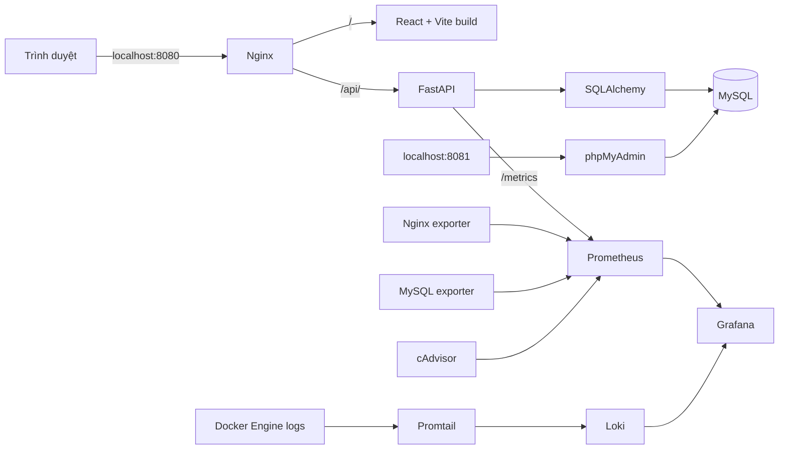
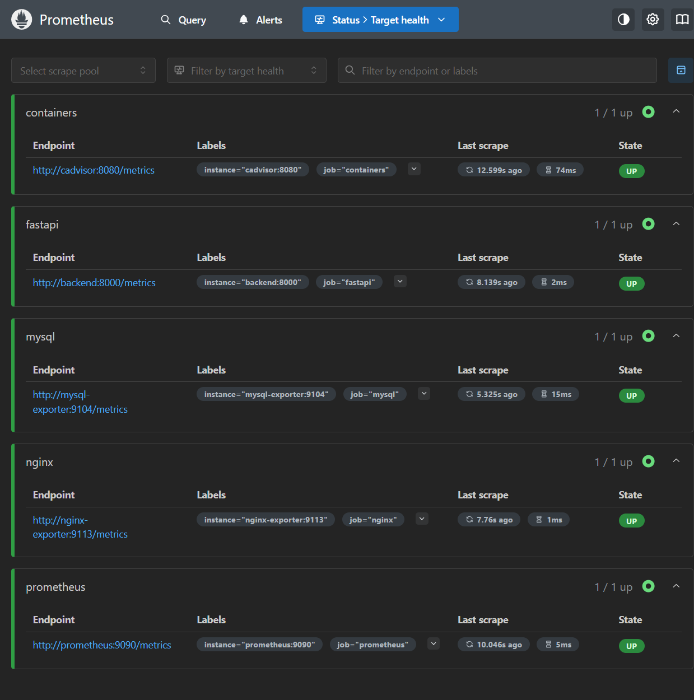
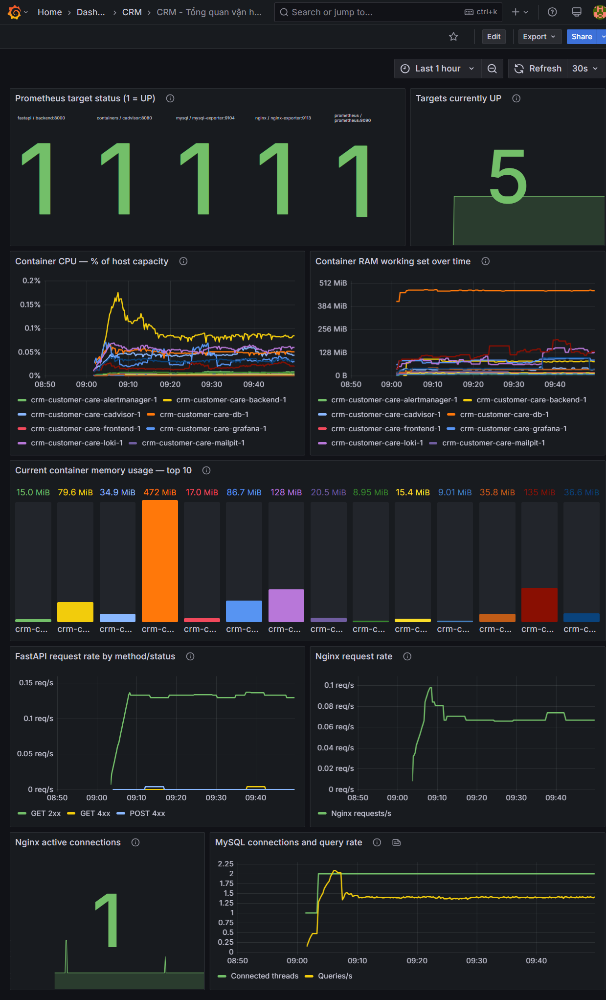
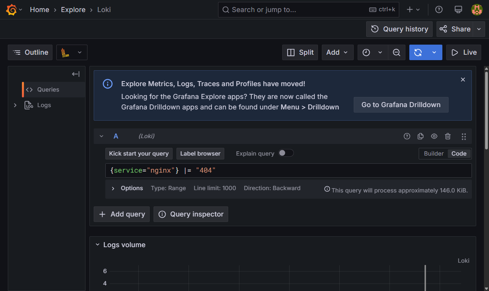
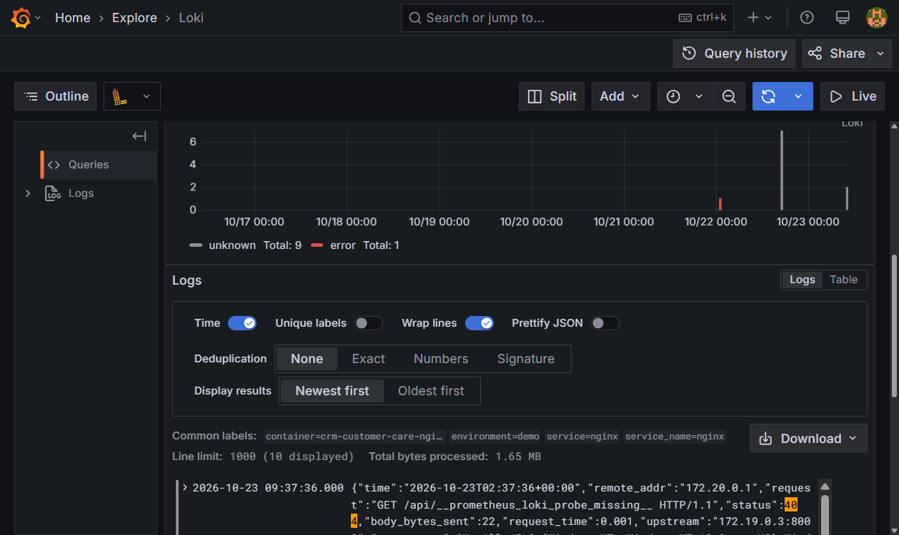

# BÁO CÁO ĐỒ ÁN — HỆ THỐNG CRM CHĂM SÓC KHÁCH HÀNG

> Bản thảo được chia thành 12 phần và có chỉ dẫn ngắt trang HTML. Chưa xuất PDF
> hoặc kiểm tra số trang thực tế; chỉ kết luận đạt tối thiểu 10 trang sau khi
> dàn trang và đếm trang trên bản xuất cuối.

## Trang 1 — Trang bìa

**ĐỀ TÀI: HỆ THỐNG CRM CHĂM SÓC KHÁCH HÀNG**

- Sinh viên: **Hoàng Tuấn**
- Mã sinh viên: **DTC245120073**
- Lớp: **CNTT K23M**
- Repository: **DTC245120073-CRM-Cham-Soc-Khach-Hang**
- Công nghệ: React, TypeScript, FastAPI, SQLAlchemy, MySQL, Docker Compose
- Năm học: **2025–2026**
- Giảng viên hướng dẫn: **Cần sinh viên bổ sung**

Đồ án xây dựng một ứng dụng web quản lý quan hệ khách hàng, giúp lưu trữ hồ sơ,
theo dõi khách hàng tiềm năng, ghi nhận tương tác, phân công công việc và quản
lý lịch hẹn. Hệ thống đóng gói bằng container và có các thành phần reverse
proxy, giám sát và tập trung log phục vụ học tập DevOps.

Ảnh bìa và logo trường chưa được cung cấp; chỉ thêm logo khi được phép sử dụng.

<div style="page-break-after: always;"></div>

## Trang 2 — Mục lục và phạm vi

1. Giới thiệu đề tài, mục tiêu và phạm vi.
2. Phân tích yêu cầu chức năng, phi chức năng.
3. Kiến trúc hệ thống và luồng request.
4. Thiết kế cơ sở dữ liệu.
5. Thiết kế giao diện và API CRM.
6. Docker Compose, MySQL và triển khai.
7. Nginx reverse proxy và hardening.
8. Prometheus, Grafana và dashboard.
9. Loki, Promtail và LogQL.
10. Kiểm thử, kết quả và giới hạn.
11. Kết luận, hướng phát triển.
12. Phụ lục vận hành và bằng chứng.

Phạm vi hiện tại là một hệ thống demo cục bộ cho nhóm nhỏ. Không bao gồm dịch
vụ gửi email/SMS thật, đồng bộ đa tenant, sao lưu ngoài site, HA database hay
cấu hình TLS production. Các chức năng tạo user, scope dữ liệu theo owner,
dashboard tổng quan và CRUD cơ bản nằm trong mã nguồn; kiểm thử deployment
phải được thực hiện trên Docker Desktop trước khi chốt báo cáo.

Mục lục trên là mục lục thủ công; cần tạo/cập nhật mục lục tự động sau khi
chuyển tài liệu sang trình soạn thảo và dàn trang.

<div style="page-break-after: always;"></div>

## Trang 3 — Giới thiệu và mục tiêu

CRM (Customer Relationship Management) hỗ trợ tổ chức tập trung thông tin và
lịch sử chăm sóc khách hàng. Khi dữ liệu nằm rải rác trong bảng tính hoặc ứng
dụng riêng, nhân viên khó nắm thời điểm liên hệ, người phụ trách và bước chăm
sóc tiếp theo. Đồ án giải quyết bài toán đó bằng ứng dụng web dùng chung một
cơ sở dữ liệu.

Mục tiêu gồm: quản lý khách hàng/lead; ghi nhận cuộc gọi, email, họp và ghi chú;
theo dõi task có hạn, độ ưu tiên; quản lý lịch hẹn; phân biệt quyền admin và
nhân viên; triển khai các dịch vụ bằng Docker Compose; quan sát metrics và
truy vấn log. Giao diện dùng tiếng Việt và co giãn cho màn hình nhỏ.

Thành phần backend sử dụng FastAPI và SQLAlchemy. Frontend gọi API cùng origin
thông qua Nginx. MySQL lưu dữ liệu bền vững bằng named volume. Prometheus
scrape các exporter và endpoint instrumented; Grafana cung cấp dashboard và
Explore. Loki lưu log trong thời hạn demo.

Chưa đính kèm ảnh dashboard CRM đã đăng nhập: kiểm tra đăng nhập Admin bằng
thông tin cấu hình hiện trả HTTP 401. Không dùng ảnh dựng hoặc dữ liệu giả để
thay minh chứng CRM.

<div style="page-break-after: always;"></div>

## Trang 4 — Phân tích yêu cầu

### Yêu cầu chức năng

- Đăng nhập và đăng xuất; token API có thời hạn.
- Dashboard đếm customer, lead, lịch hẹn và công việc đang mở.
- CRUD customers, leads, interactions, tasks và appointments.
- Tìm khách hàng/lead theo tên hoặc email; xác nhận trước khi xóa.
- Chuyển lead thành customer, ghi nhật ký thao tác quan trọng.
- Admin tạo tài khoản, xem tài khoản và khóa/mở khóa nhân viên.
- Admin truy cập toàn dữ liệu; nhân viên chỉ thao tác bản ghi thuộc mình.
- Dùng phpMyAdmin để kiểm tra MySQL và cung cấp health/metrics cho giám sát.

### Yêu cầu phi chức năng

Giao diện responsive; API xác thực input; password hash bằng Argon2; cấu hình
secret qua environment; database không publish cổng; healthcheck và restart
policy; log truy cập Nginx; giới hạn retention log; repo không chứa `.env`.
Hiệu năng và mức tải chưa được benchmark trong bản demo.

| Vai trò | Quyền chính |
|---|---|
| Admin | Quản lý user; đọc/sửa dữ liệu mọi nhân viên |
| Nhân viên | Tạo và quản lý dữ liệu do chính mình sở hữu |

<div style="page-break-after: always;"></div>

## Trang 5 — Kiến trúc và luồng request



Request giao diện đến host port 8080, được Nginx chuyển tiếp đến frontend.
Trình duyệt gọi `/api/...` trên cùng host; Nginx proxy sang FastAPI trong mạng
Docker. Backend tạo/đọc dữ liệu MySQL qua tên dịch vụ `db`, không dùng IP tĩnh.
Các cổng quản trị được bind ở loopback trên host, không bind mọi giao diện.

Compose nền chứa ứng dụng, Compose monitoring bổ sung metrics, Compose logging
bổ sung Loki/Promtail. Tách file giúp kiểm thử từng mốc độc lập và tạo commit
theo yêu cầu. Mạng application/monitoring được khai báo internal; database
không có `ports`.

Sơ đồ kiến trúc được nhúng trực tiếp bằng Mermaid ở trên; chưa xuất ảnh riêng.

<div style="page-break-after: always;"></div>

## Trang 6 — Cơ sở dữ liệu và giao diện

Các bảng chính: `users`, `customers`, `leads`, `interactions`, `tasks`,
`appointments`, `audit_logs`. Các bản ghi nghiệp vụ có `owner_id` khóa ngoại
đến `users`; interaction/task/appointment liên kết đến customer. Lead có thể
được chuyển đổi và lưu `converted_customer_id`. Các cột id dùng khóa chính;
email user unique; customer name/email có index tìm kiếm; trường owner và
foreign key được index phù hợp.

`backend/app/models.py` khai báo SQLAlchemy models. Khi API khởi chạy, SQLAlchemy
`create_all` tạo các bảng chưa có; thao tác này không thay thế migration khi
schema thay đổi. MySQL volume giữ dữ liệu khi container được tạo lại. Dữ liệu
ban đầu chỉ gồm admin cấu hình từ `.env`; không nạp bộ khách hàng giả.

Giao diện có dashboard card, danh sách có tìm kiếm, biểu mẫu thêm/sửa, cảnh báo
xác nhận xóa và layout responsive. Công việc quá hạn và cuộc hẹn đến giờ nhắc
được hiển thị trên dashboard; thời gian nhắc được API chuẩn hóa theo UTC.
Các quan hệ customer được nhập bằng ID ở bản demo; hướng nâng cấp là
autocomplete tìm customer.

Chưa có ảnh phpMyAdmin đã đăng nhập hoặc CRUD CRM thành công; phần này cần bổ
sung sau khi xử lý quyền truy cập CRM. Không chụp hoặc đưa dữ liệu khách hàng
có thông tin cá nhân vào báo cáo nếu chưa được phép.

<div style="page-break-after: always;"></div>

## Trang 7 — Docker Compose và Nginx

Docker Compose điều phối MySQL, FastAPI, frontend tĩnh và Nginx. MySQL dùng
named volume. API chờ healthcheck database; healthcheck API được Nginx dùng
trong depends_on. Backend chạy bằng user không phải root, filesystem read-only
và tmpfs riêng cho `/tmp`. Container ứng dụng áp dụng `no-new-privileges`.

Nginx là điểm truy cập chính, forward `/api/` tới backend, `/` tới frontend.
Access log xuất stdout dạng JSON, error log ra stderr. Cấu hình có header
`X-Content-Type-Options`, `X-Frame-Options`, `Referrer-Policy`,
`Permissions-Policy`, CSP; request body tối đa 10 MB và timeout proxy giới
hạn. Stub status chỉ phục vụ exporter trong network.

Demo chạy HTTP localhost, chưa có TLS. Đưa ra Internet cần TLS hợp lệ, firewall,
secret store, rate limiting, backup/restore, cập nhật image, cấu hình cookie/
token phù hợp và kiểm thử bảo mật độc lập.

Các lần kiểm tra trước ghi nhận health endpoint HTTP 200 và security headers
được trả từ Nginx; ảnh chụp terminal tương ứng chưa được lưu trong thư mục minh
chứng.

<div style="page-break-after: always;"></div>

## Trang 8 — Prometheus và Grafana

Prometheus scrape FastAPI `/metrics`, nginx-prometheus-exporter, mysqld-exporter
và cAdvisor mỗi 15 giây. Targets sử dụng DNS service trong network Compose.
MySQL exporter dùng user riêng `crm_metrics` có quyền `PROCESS`,
`REPLICATION CLIENT`, `SELECT`; database app không được publish trực tiếp.
Grafana provisioning tự khai báo Prometheus datasource và dashboard JSON.
Alertmanager có giao diện riêng. Dashboard `crm-overview` gồm 9 panel: scrape status theo target,
tổng target UP, CPU theo phần trăm năng lực host, RAM working set theo thời
gian và top 10 hiện tại, FastAPI request rate theo method/status, Nginx request
rate/kết nối và MySQL kết nối/query rate.

CPU container được tính từ rate CPU usage chia cho `machine_cpu_cores`, không
phải phần trăm CPU quota container. Alert
`ContainerCpuUsageAbove90Percent` dùng cùng phép chuẩn hóa, điều kiện trên
90% liên tục 3 phút và gửi email notification qua Alertmanager đến Mailpit
local. Cần bật Compose profile `mailpit` để nhận thư; không có tải thực vượt
ngưỡng thì alert không firing. Metric `up=1` cho biết scrape thành công.
Dashboard chỉ có dữ liệu sau khi scrape chạy; tạo request thật để tạo traffic.
Trên Windows, chỉ số container phụ thuộc Docker Desktop Linux VM và quyền đọc
mount cAdvisor.

Ảnh Targets và dashboard ở dưới được chụp trực tiếp từ giao diện đang chạy
ngày 23/10/2026. Không điền số đo CPU/RAM ngoài dữ liệu quan sát được.

Kết quả kiểm tra cục bộ ngày 23/10/2026: cả năm job `prometheus`, `fastapi`,
`nginx`, `mysql`, `containers` ở trạng thái `UP`; Prometheus trả 5 series cho
`up`, có dữ liệu cho `http_requests_total`, `mysql_up=1`,
`nginx_up=1` và `container_memory_working_set_bytes`. Grafana API health báo
database `ok`, đã provision datasource Prometheus/Loki và dashboard
`crm-overview`; ảnh dashboard đang chạy được đính kèm bên dưới.

Kiểm tra bổ sung ngày 23/10/2026: `promtool check rules` chấp nhận CPU alert;
`amtool check-config` chấp nhận route/receiver. Sau khi áp dụng Compose, cả năm
target scrape đều `UP`, `machine_cpu_cores=16`, Prometheus rule được nạp và
đang `inactive` (không có container vượt 90% host CPU liên tục 3 phút).
Dashboard API trả về 9 panel; các truy vấn PromQL cho CPU, RAM, FastAPI, Nginx
và MySQL đều trả series thật. Kiểm thử gửi một alert tổng hợp riêng biệt xác
nhận email `[FIRING:1] SyntheticNotificationTest (info)` tới Mailpit
`admin@localhost`; đây chỉ xác nhận notification pipeline, không phải CPU
alert đã firing. Alertmanager và Grafana health endpoints trả HTTP 200. Named
volumes được giữ nguyên khi áp dụng Compose.





<div style="page-break-after: always;"></div>

## Trang 9 — Loki, Promtail và LogQL

Promtail dùng Docker service discovery qua Docker Engine socket và chỉ giữ log
các container backend, Nginx, database, frontend. Labels gồm `service`,
`container`, `environment=demo`. Docker pipeline stage giải mã JSON log.
Promtail gửi batch đến Loki trên network nội bộ. Loki dùng filesystem storage,
retention 168 giờ và named volume.

Truy vấn dùng trong Grafana Explore:

```logql
{service="backend"}
{service="nginx"} |= "/health"
{service="nginx"} |= "404"
```

Các truy vấn trên đã được gửi đến Loki ngày 23/10/2026 và trả log thực. Trong
lần kiểm tra trước, datasource health qua Grafana trả `OK`; truy vấn qua Grafana
proxy trả 39 dòng Nginx, 81 dòng backend và 3 dòng backend khớp lỗi sau request
validation 422. Ở lần chụp giao diện ngày 23/10/2026, truy vấn
`{service="nginx"} |= "404"` với khoảng thời gian **Last 7 days** trả các
dòng access log thật có status 404. Request validation 422 gửi body `{}` đến
endpoint đăng nhập và request 404 được tạo bằng đường dẫn probe; cả hai không
ghi dữ liệu CRM. Số dòng thay đổi theo thời gian.

Promtail `/ready` trả `Ready`, Loki `/ready` trả `ready`. Labels Loki gồm
`service`, `container`, `environment` và `service_name`. Trong ba phút cuối
khi kiểm tra không có warning/error mới từ Loki/Promtail.

Promtail đã hết hỗ trợ upstream trong năm 2026; vẫn dùng trong đồ án do yêu
cầu cụ thể. Hướng sản xuất là đánh giá chuyển sang Grafana Alloy.





<div style="page-break-after: always;"></div>

## Trang 10 — Hardening và kiểm thử

Checklist hiện có trong README ghi rõ file và cách kiểm tra. Các kiểm soát
được đưa vào cấu hình gồm secret qua `.env`, database network nội bộ, user
exporter giới hạn quyền, mật khẩu user Argon2, JWT expiration, role/owner scope,
audit log, non-root backend, read-only filesystem, no-new-privileges, giới hạn
cổng localhost và security headers. Phần mở Docker socket cho Promtail là
ngoại lệ có rủi ro rõ ràng.

Kiểm thử tự động backend dùng SQLite tạm để kiểm tra health, auth, customer
CRUD, dashboard. Frontend chạy TypeScript check và Vite production build.
Smoke test MySQL thật qua Compose đã gọi `SELECT 1` và nhận kết quả `1`; test
SQLite không chứng minh exporter scrape hoặc Loki ingest thành công.

**Kết quả kiểm thử triển khai ngày 23/10/2026:** Docker Engine 26.1.4,
Docker Compose 2.27.1. Compose cấu hình hợp lệ; frontend TypeScript check và
production build thành công; backend pytest có 11 test pass trên Python 3.12.
Stack chạy được; MySQL `SELECT 1` trả `1`; website, `/health` và OpenAPI qua
Nginx trả HTTP 200. Năm Prometheus target ở trạng thái `UP`; Grafana health
`ok`; Loki trả log cho các selector backend/nginx/db. Kiểm tra login bằng
thông tin cấu hình trả HTTP 401 dù tài khoản khớp email vẫn đang active; chưa
đặt lại mật khẩu hoặc thay đổi dữ liệu tài khoản. Do đó luồng CRUD qua giao
diện sau đăng nhập chưa được nghiệm thu.

Kiểm tra runtime hardening: backend chạy UID `10001`, root filesystem
read-only, bật `no-new-privileges`; MySQL không publish port host; cổng Nginx,
Grafana và phpMyAdmin chỉ bind `127.0.0.1`. Nginx hiện chạy HTTP cục bộ, chưa
cấu hình HTTPS; security headers đã được xác nhận trên response.

Kết quả lệnh test và build được ghi ở trên; ảnh chụp terminal chưa được lưu.
Đăng nhập Admin vẫn là lỗi nghiệm thu còn mở và không được khắc phục bằng cách
ghi đè mật khẩu hiện lưu khi chưa có xác nhận của chủ tài khoản.

<div style="page-break-after: always;"></div>

## Trang 11 — Đánh giá, hạn chế và hướng phát triển

Ứng dụng cung cấp luồng cơ bản để demo quản lý quan hệ khách hàng và tách bạch
service bằng container. Compose modular hỗ trợ trình bày từng mốc Nginx,
monitoring, logging. Dashboard và log system giúp quan sát hoạt động thay vì
chỉ xem container có chạy hay không.

Hạn chế hiện tại: schema tạo tự động chưa có Alembic migrations; CRUD chưa có
pagination nâng cao; nhập liên kết bằng ID; quy trình password reset đã có
nhưng cần SMTP/Mailpit cấu hình để gửi thư; chưa có refresh token, rate limit
đăng nhập, MFA, CSRF cookie flow hoặc phân quyền theo team;
không có CI/CD, backup tự động/khôi phục đã diễn tập, HA hay TLS. Loki dùng
filesystem; Promtail đã EOL; Docker socket cần bảo vệ nghiêm ngặt. Compose
không cấu hình resource limits cố định để tránh làm máy demo thiếu tài nguyên.

Hướng phát triển: Alembic, API pagination/filter, UI autocomplete, unit/integration
tests trên MySQL ephemeral, CI GitHub Actions, TLS/secret manager, rate limiting,
database backup rotation, Grafana alerting, chuyển Alloy và đánh giá resource
requests theo workload đo thực.

<div style="page-break-after: always;"></div>

## Trang 12 — Kết luận và phụ lục minh chứng

Đồ án hiện có frontend, backend, MySQL, reverse proxy, dashboard metrics và
pipeline log; kiểm thử backend/frontend và các màn hình Prometheus/Grafana
được ghi nhận. Chưa thể kết luận nghiệm thu hoàn tất: đăng nhập Admin trả HTTP
401; năm học/giảng viên hướng dẫn còn chờ thông tin; remote GitHub chưa được
cấu hình; báo cáo chưa xuất PDF để xác nhận đủ 10 trang. Không tự đặt mật khẩu,
thông tin học vụ, remote hoặc kết quả kiểm thử thay cho người dùng.

### Phụ lục lệnh và minh chứng

```powershell
docker compose -f docker-compose.yml -f docker-compose.monitoring.yml -f docker-compose.logging.yml --profile admin up -d --build
docker compose -f docker-compose.yml -f docker-compose.monitoring.yml -f docker-compose.logging.yml ps
docker compose -f docker-compose.yml -f docker-compose.monitoring.yml -f docker-compose.logging.yml logs --tail 100
git --no-pager log -3 --oneline
```

| Minh chứng | Trạng thái |
|---|---|
| CRM dashboard và CRUD customer | Chưa có; đăng nhập Admin cần được khắc phục |
| MySQL tables trong phpMyAdmin | Chưa có ảnh; MySQL `SELECT 1` đã được xác nhận |
| Nginx headers/healthcheck | Health/header đã được kiểm tra; chưa lưu ảnh terminal |
| Prometheus targets UP | `docs/images/prometheus-targets.png` |
| Dashboard metrics có dữ liệu | `docs/images/grafana-dashboard.png` |
| LogQL và log thật trong Explore | `docs/images/grafana-explore-loki-404.png`, `docs/images/grafana-explore-results.png` |
| Prometheus CPU rule đã nạp | `docs/images/prometheus-rules.png` |
| Lịch sử ba commit | Ba commit cục bộ theo thứ tự app/Nginx, monitoring, logging/docs; chưa có remote để push |

**Kết luận:** phần monitoring/logging có bằng chứng ảnh chụp thực tế. Báo cáo
vẫn là bản thảo cho đến khi bổ sung tên giảng viên hướng dẫn, xử lý hoặc xác
nhận chấp nhận giới hạn đăng nhập, cấu hình remote GitHub nếu cần nộp online,
xuất tài liệu và kiểm tra số trang cuối cùng.
